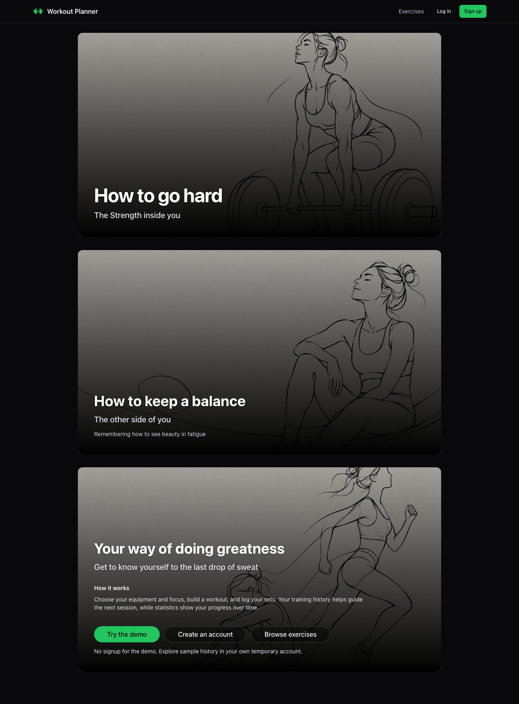
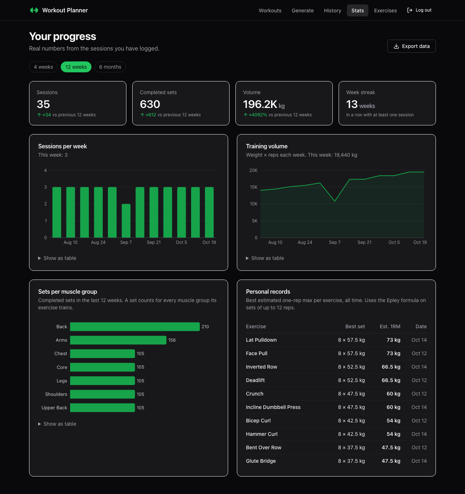

# Workout Planner

**A full-stack training app built for the moments between sets.** Generate an equipment-aware workout, log your training, and see how your history shapes the next session.

[Architecture and engineering decisions](docs/ARCHITECTURE.md) · [Deployment and rollback](docs/DEPLOYMENT.md) · [Security review](docs/SECURITY.md) · [Portfolio case study](docs/CASE_STUDY.md) · [Verification results](docs/VERIFICATION.md)

Start the app and choose **Try the demo** at the bottom of the scrolling homepage. Each visitor gets an isolated temporary account with 12 weeks of sample training. Demo data expires after 24 hours; MongoDB removes it asynchronously. No shared credentials or signup required.


A workout planner that adapts to what you actually did. Generate a workout in a few taps, log your sets at the gym, and let your history shape what comes next:

- **Progressive overload built in.** When every set of an exercise hit its reps last time, the logger suggests the next step up: +2.5 kg, +1 rep, or +5 seconds.
- **Training-recency recommendations.** The wizard recommends the muscle group you trained longest ago, prefers exercises you have not done in the last week, and matches the equipment you have today.
- **Made for the gym floor.** An installable app with a rest timer, big tap targets, and drafts that survive a refresh or a locked phone.

New here? The [step-by-step guide](docs/GUIDE.md) walks through setup with a free MongoDB Atlas database, everyday use, making changes and troubleshooting.

## Product views




[Mobile homepage](docs/screenshots/home-mobile.png) · [Mobile statistics](docs/screenshots/statistics-mobile.png)

## Features

- **Accounts:** sign up and log in with revocable HttpOnly cookie sessions. Password rules are shared between the API and the form.
- **Workouts:** build a workout by hand, or generate one from a primary focus, secondary focus, finisher and available equipment. Swap, remove or add exercises before saving.
- **Quick start:** new users can jump straight to a sensible first plan, then adjust it before saving.
- **Session logging:** follow a workout or log freestyle. Each exercise shows last time's sets; ticking a set fills in the target.
- **Repeatable training:** the logger explains when to repeat a previous target, remembers your preferred rest length and keeps the suggested target visible.
- **History:** every session grouped by week, with editing and deleting.
- **Statistics:** sessions, sets, volume and week streak compared with the previous period, weekly charts, sets per muscle group, estimated one-rep-max records and portable JSON export.
- **Exercise library:** searchable and filterable, with the muscle groups and equipment for each exercise.

## Tech stack

| Area | Tools |
| --- | --- |
| Frontend | React 19, Vite 8, Tailwind CSS 4, TanStack Query, React Router 7, React Hook Form, Radix UI, Recharts, lucide 1, framer-motion 13, vite-plugin-pwa |
| Backend | Node.js 24.22.1+ (runs TypeScript directly), Express 5, Mongoose 9, cookie sessions, express-rate-limit |
| Shared | zod 4 schemas and TypeScript types in `packages/shared`, used by both apps |
| Tooling | pnpm 12 workspaces, TypeScript 7, Biome 2, Vitest 5, Testing Library, Supertest, mongodb-memory-server |

## Project structure

```
backend/          Express API (src/app.ts builds the app, src/server.ts starts it)
frontend/         React app
packages/shared/  Validation schemas and API types shared by both
scripts/          Repository scripts, such as creating the .env files
docs/             The step-by-step guide
```

## Prerequisites

- Node.js 24.22.1 or a newer patched 24.x release. `.nvmrc` pins the reviewed October 2026 security release.
- pnpm on your PATH. The version is pinned in `package.json`; run `corepack enable pnpm` once to get it (corepack ships with Node). With nvm, run it again after switching Node versions.
- A MongoDB 5.0+ database: a free [MongoDB Atlas](https://cloud.mongodb.com) cluster, or MongoDB running locally in Docker. The [guide](docs/GUIDE.md) covers both. Statistics use `$dateTrunc`, which needs 5.0.

## Getting started

```bash
pnpm install

# Create backend/.env (with a generated TOKEN_SECRET) and frontend/.env. Never overwrites.
pnpm run env:create

# Put your MongoDB connection string in backend/.env (MONGODB_URI), then load the
# muscle groups and exercises. Safe to run again at any time.
pnpm seed
pnpm indexes

# Start the API (http://localhost:3000) and the app (http://localhost:5173)
pnpm dev
```

See the [guide](docs/GUIDE.md) for creating the Atlas cluster and checking the data in MongoDB Compass.

### Environment variables

**backend/.env**

| Variable | Default | Description |
| --- | --- | --- |
| `MONGODB_URI` | `mongodb://localhost:27017/workout-planner` | MongoDB connection string. If it names no database, as Atlas strings don't, `workout-planner` is used |
| `TOKEN_SECRET` | none (required) | Session-token HMAC secret, at least 32 characters. `pnpm run env:create` generates one |
| `PORT` | `3000` | API port |
| `CORS_ORIGIN` | `http://localhost:5173` | Comma-separated list of allowed frontend origins. The example file also allows `http://localhost:4173` for `pnpm preview` |
| `TRUST_PROXY` | `0` | Number of reverse proxies in front of the API, so rate limiting sees client IPs |
| `NODE_ENV` | `development` | `development`, `test` or `production` |

The API validates these at startup and exits with a clear message if something is missing. If it can't reach the database, it says why and what to check.

**frontend/.env**

| Variable | Default | Description |
| --- | --- | --- |
| `VITE_BACKEND_URL` | `/api` | Base URL of the API; `/api` uses the Vite dev proxy and the same-origin production server |

## Scripts

Run from the repository root:

| Command | What it does |
| --- | --- |
| `pnpm dev` | Starts the API and the frontend together, in watch mode |
| `pnpm run env:create` | Creates missing `.env` files from the examples, with a generated `TOKEN_SECRET` |
| `pnpm seed` | Upserts muscle groups and exercises (ids stay stable) |
| `pnpm run check-data` | Prints which database you're connected to and how much data it holds |
| `pnpm indexes` | Creates declared database indexes explicitly; never drops indexes |
| `pnpm test:e2e` | Runs real browser journeys on desktop and mobile; build first |
| `pnpm audit:security` | Checks all dependencies for known advisories |
| `pnpm test` | Runs every test suite |
| `pnpm typecheck` | Type-checks every package |
| `pnpm lint` | Lints with Biome |
| `pnpm check:fix` | Formats, organizes imports and applies safe lint fixes |
| `pnpm build` | Builds the frontend for production |
| `pnpm preview` | Builds the frontend, then serves it on http://localhost:4173 with the API, as in production |

Backend tests start an in-memory MongoDB, so they need no database. The first run downloads a MongoDB binary.

## API overview

Production API routes live under `/api`. Every private route requires the HttpOnly session cookie; every write also requires `X-CSRF-Protection: 1` and an allowed browser Origin. Users can only see and change their own data. Browser clients never read or store authentication tokens. Development also accepts the legacy unprefixed API paths.

Session creation accepts a `clientRequestId` UUID and `X-Session-Owner` header for safe retries. Repeated requests return the same session; conflicting reuse returns 409. Session updates require the original `expectedUpdatedAt` timestamp and reject stale edits.

| Method and path | Description |
| --- | --- |
| `GET /health` | API status; 503 when the database is unreachable |
| `POST /auth/signup` | Create an account; sets cookie and returns `{ user }` |
| `POST /auth/login` | Log in; sets cookie and returns `{ user }` |
| `POST /auth/demo` | Isolated, populated demo account |
| `POST /auth/logout` | Revokes this session on the server and clears the cookie |
| `GET /auth/verify` | The current session user |
| `GET /exercises?muscleGroups=Legs,Back` | Exercises, optionally filtered by muscle group names (any casing) |
| `GET /musclegroups` | Muscle groups |
| `GET/POST /workouts`, `GET/PUT/DELETE /workouts/:id` | Workouts |
| `GET/POST /sessions`, `GET/PUT/DELETE /sessions/:id` | Logged sessions; the list pages with `?limit=&before=<ISO date>~<id>` |
| `GET /sessions/recent-exercises` | Complete seven-day exercise recency window |
| `GET /sessions/last-performance?exercises=<ids>` | Most recent sets for each exercise |
| `GET /sessions/stats?weeks=12&tz=Europe/Helsinki` | Weekly totals, streak, sets per muscle group, records |

## Upgrading an existing installation

Read [the deployment guide](docs/DEPLOYMENT.md) before rollout. Users sign in again after the switch from JWTs. The browser removes old stored JWTs. Run `pnpm indexes` as a release step; app startup no longer drops or synchronizes indexes. Keep the previous image and take a database backup before a release. Existing workouts and sessions remain compatible.

## Reliability and offline behavior

New sessions are written to an account-scoped browser outbox before transmission. If a request fails or its response is lost, the same immutable request can be retried without creating a duplicate. Pending saves survive reloads and can be exported. Retries run while the app is open, on reconnect/focus, and every 30 seconds. Sign in again if the session expires. Failed edits keep a local draft with their original revision; editing conflicts require review rather than silently overwriting another device.

Previously fetched API data is cached on this device for use during connection failures. Offline identity is only a local display hint; the server always verifies its own cookie session. Explicit logout clears cached API data and offline identity, while drafts and pending saves remain scoped to their original account. Device storage can be cleared by the browser and is not an encrypted backup. No service-worker background-sync support is assumed.

## Browser tests

```bash
pnpm exec playwright install chromium
VITE_BACKEND_URL=/api pnpm build
pnpm test:e2e
```

The browser tests launch a disposable MongoDB database and serve the production frontend build with the real API. They do not connect to your configured Atlas database. CI also runs formatting, types, unit/integration tests, the dependency audit, and the production build.
