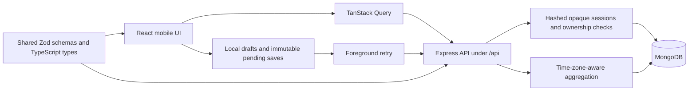

# Architecture and decisions

## One application origin

The production Express server serves the built frontend and `/api`. SameSite=Strict, Secure, HttpOnly cookies need no cross-site cookie exception. Development uses a Vite `/api` proxy. The API validates a custom CSRF header and allowed origins on every mutation, including login and logout. Browser cookies contain 256 bits of random session material; MongoDB stores only an HMAC verifier. Logout deletes the server session. Expiry is checked during authentication, independent of MongoDB TTL cleanup.

Tradeoff: a server-side session lookup adds a database read per request but allows immediate revocation and current user validation. TOKEN_SECRET rotation invalidates all sessions. There is no refresh-token family or JavaScript-readable credential to manage.

## Shared request contracts

Zod validates untrusted requests at the API boundary and drives client form validation. Mongoose models enforce persistence constraints. Strict input objects reject owner assignment and MongoDB operator injection. Response types describe serialized IDs and dates. Business rules are small functions or services rather than framework-dependent abstractions.

## Reliable session creation

Before sending a new session, the browser stores an immutable snapshot under an account ID and UUID. The server hashes the validated request and enforces a unique `(belongsTo, clientRequestId)` index. Concurrent retries either create one document or read the existing one. Reusing an ID with different data returns 409. An account header prevents a pending request from being attached to a different cookie session after an account switch. This constraint requires the explicit index deployment step.

Tradeoff: localStorage keeps the queue inspectable and dependency-free, but has limited capacity and synchronous writes. Each pending session has its own key to avoid replacing another tab's queue. Storage failure blocks the save with an explanation. This is foreground synchronization, not a guarantee that a closed app will upload. Pending saves are not a backup and must not contain credentials.

## Concurrent edits

Edits carry the `updatedAt` revision from the original document. An atomic conditional update checks owner, ID and revision. A stale write returns 409. Drafts preserve the original revision across reloads so they cannot silently masquerade as a fresh edit. Users must reconcile with the latest server state; automatic merging of sets is intentionally absent.

## Stable history

Sessions sort by `(performedAt desc, _id desc)`. Cursors include both fields and the database index begins with the owner. This prevents missing sessions when timestamps tie, including JSON exports. The recency endpoint queries the entire seven-day window rather than a history page.

## Historical snapshots and statistics

Sessions snapshot the workout name so renaming or deleting a plan does not rewrite training history. Exercise catalogue IDs are stable across seeding. Aggregations count completed sets and use the viewer's time zone for week boundaries. Estimated records use Epley's formula and limit the rep range; these are estimates, not verified lifts. Training-recency suggestions are a transparent heuristic, not a recovery measurement.

## Operations

Index creation is a release command, never a destructive startup synchronization. Structured request logs contain request ID, method, path, status and duration, excluding cookies, bodies, secrets and query strings. Health checks report database readiness. SIGTERM closes the HTTP server and database with a ten-second shutdown deadline. The production image runs as an unprivileged user. Shared TypeScript is compiled to JavaScript for deployed dependencies: Node does not strip TypeScript inside node_modules. The workout-production export condition selects that compiled entry point.
